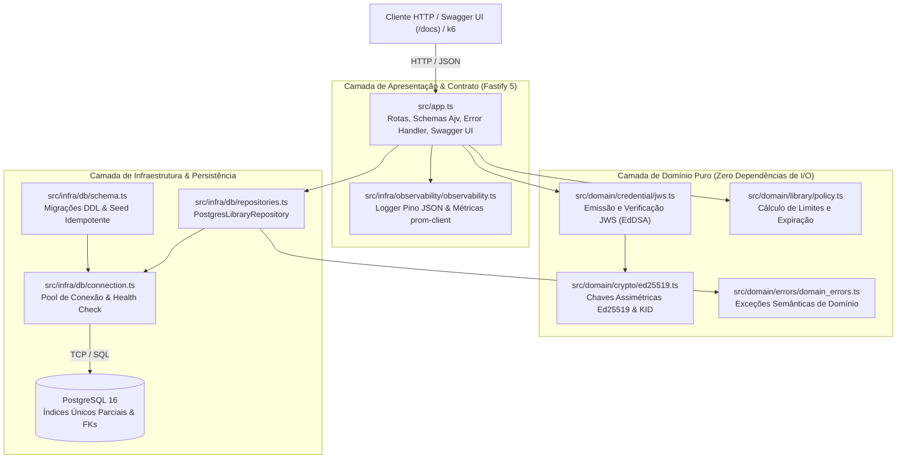
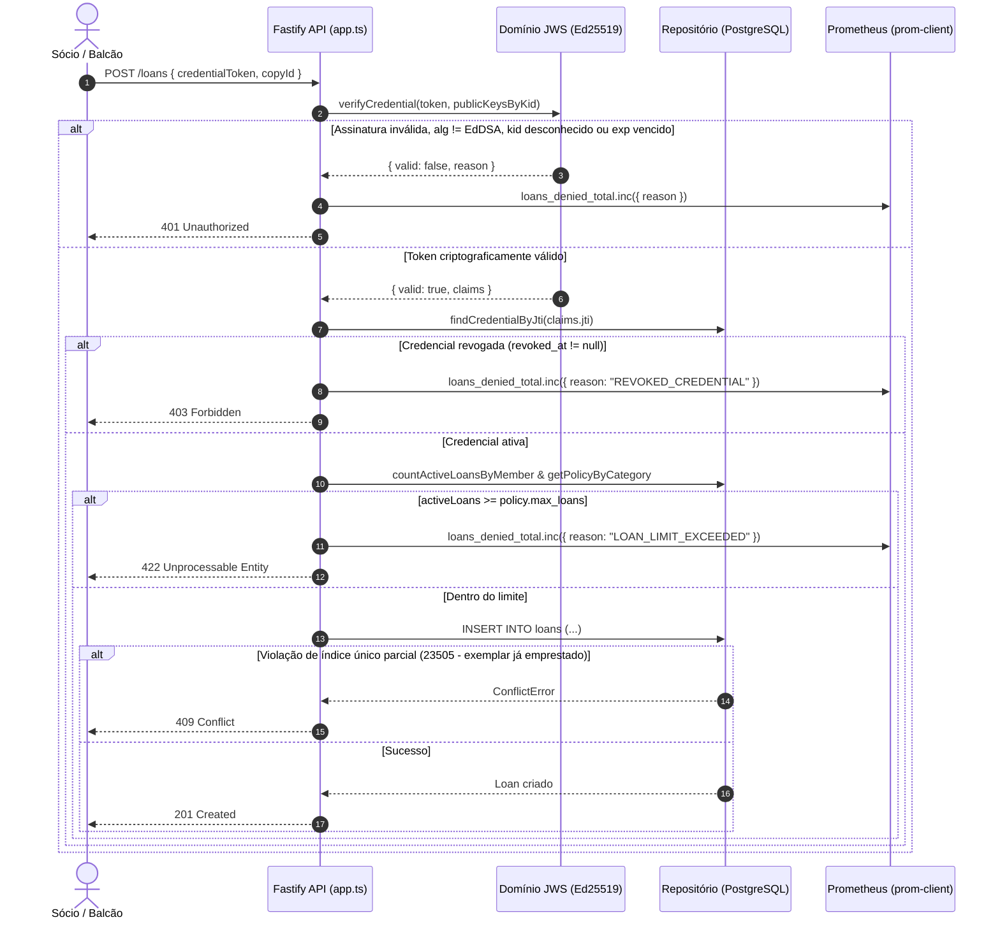
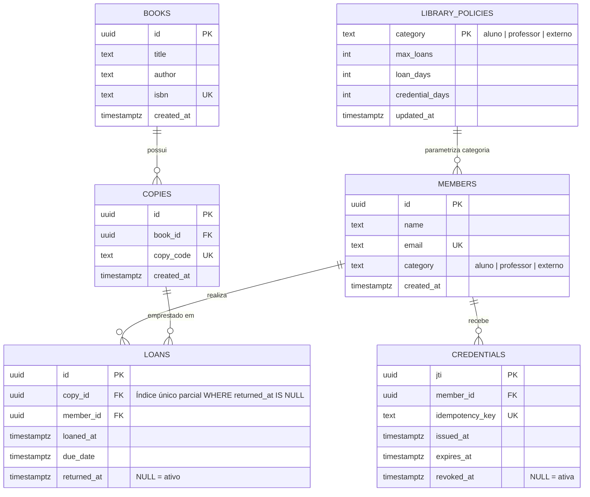

Nível: B

# API de Biblioteca com Carteirinha Digital (JWS Ed25519)

API RESTful desenvolvida em **Deno 2 + TypeScript + Fastify 5 + PostgreSQL** para gestão de acervo bibliográfico, emissão idempotente e revogação de carteirinhas digitais assinadas criptograficamente (**JWS / EdDSA**) e controle transacional de empréstimos com políticas dinâmicas persistidas em banco de dados.

---

## Sumário

1. [Visão Geral e Problema Resolvido](#1-visão-geral-e-problema-resolvido)
2. [Arquitetura Detalhada e Decisões de Engenharia (ADRs)](#2-arquitetura-detalhada-e-decisões-de-engenharia-adrs)
3. [Modelagem de Dados e Regras de Negócio](#3-modelagem-de-dados-e-regras-de-negócio)
4. [Catálogo de Endpoints e Semântica de Erros](#4-catálogo-de-endpoints-e-semântica-de-erros)
5. [Observabilidade, Logs Estruturados e SLO](#5-observabilidade-logs-estruturados-e-slo)
6. [Como Executar o Projeto](#6-como-executar-o-projeto)
7. [Testes Automatizados, Carga (k6) e Evidências de Qualidade](#7-testes-automatizados-carga-k6-e-evidências-de-qualidade)
8. [Documentação Complementar e Artefatos](#8-documentação-complementar-e-artefatos)

---

## 1. Visão Geral e Problema Resolvido

Sistemas tradicionais de biblioteca frequentemente dependem de identificadores estáticos vulneráveis a falsificação ou exigem múltiplas consultas acopladas para validar identidade e elegibilidade no momento do empréstimo.

Este projeto implementa um **Monólito Modular** de alta confiabilidade que resolve três desafios centrais:

* **Autenticidade Criptográfica Desacoplada:** Emissão de carteirinhas digitais como tokens **JWS (JSON Web Signature)** compactos (`header.payload.signature`) assinados com curva elíptica **Ed25519 (`EdDSA`)** via Web Crypto API nativa. A verificação da assinatura e da expiração (`exp`) ocorre de forma pura em memória, consultando o banco apenas para revogação (`jti`) e regras vigentes.
* **Integridade Atômica sob Concorrência:** Garantia no próprio motor do PostgreSQL (via **índice único parcial**) de que um exemplar físico (`copy_id`) nunca seja emprestado simultaneamente para dois sócios, eliminando *race conditions* sem necessidade de locks distribuídos externos.
* **Políticas Dinâmicas Sem Downtime:** Limites de empréstimos simultâneos (`max_loans`), prazos de devolução (`loan_days`) e validade da carteirinha (`credential_days`) são persistidos na tabela `library_policies` e podem ser consultados e reconfigurados em tempo de execução via API (`GET /policies` e `PUT /policies/:category`).

---

## 2. Arquitetura Detalhada e Decisões de Engenharia (ADRs)

A aplicação segue os princípios de **Clean Architecture / Hexagonal (Ports & Adapters)** adaptados a um monólito modular, isolando completamente as regras de negócio e criptografia (`src/domain`) dos detalhes de transporte HTTP, banco de dados e telemetria (`src/infra`).

### 2.1. Diagrama de Arquitetura em Camadas



### 2.2. Fluxo de Empréstimo com Verificação Criptográfica e Concorrência



### 2.3. Decisões Arquiteturais Registradas (ADRs)

* **[ADR-0001 — Garantia de Unicidade em Empréstimos Ativos](docs/adr/0001-concorrencia-emprestimos.md):** Adoção de índice único parcial no PostgreSQL (`CREATE UNIQUE INDEX idx_active_loan_per_copy ON loans (copy_id) WHERE returned_at IS NULL;`) em vez de locks distribuídos na aplicação, garantindo atomicidade nativa sob concorrência.
* **[ADR-0002 — Formato da Credencial Digital](docs/adr/0002-formato-da-credencial.md):** Implementação própria de **JWS compacto** sobre Web Crypto API nativa com algoritmo estritamente fixado em **`EdDSA` (Ed25519)** e cabeçalho `kid`, prevenindo ataques de downgrade (`alg: none` ou `HS256`) e evitando problemas de canonicalização JSON.
* **[Spike Técnico Deno 2](docs/spike-deno.md):** Validação prévia de interoperabilidade (`Deno 2` + `npm:fastify` + `postgres` + `pino` + `prom-client`) e definição de execução com princípio do menor privilégio (`USER deno` e flags explícitas `--allow-net --allow-env --allow-read --allow-sys=networkInterfaces,hostname`).

### 2.4. Estrutura de Diretórios

```text
├── .github/workflows/           # Pipeline CI (deno fmt, lint, check, test + PostgreSQL)
├── docs/
│   ├── adr/
│   │   ├── 0001-concorrencia-emprestimos.md
│   │   └── 0002-formato-da-credencial.md
│   ├── dominio.md               # Vocabulário, invariantes (I1–I11) e catálogo de erros
│   ├── ia.md                    # Declaração transparente de uso de IA e validação
│   ├── openapi.yml              # Contrato OpenAPI 3.1 da API
│   ├── spike-deno.md            # Relatório da spike técnica de viabilidade
│   └── TEST_PLAN.md             # Plano de testes, evidências de cobertura e roteiro k6
├── k6/
│   └── smoke.js                 # Teste de carga e validação automática de SLO
├── src/
│   ├── domain/
│   │   ├── credential/          # jws.ts e jws_test.ts (assinatura, verificação e testes negativos)
│   │   ├── crypto/              # ed25519.ts e ed25519_test.ts (chaves assimétricas e JWK)
│   │   ├── errors/              # domain_errors.ts (NotFoundError, ConflictError, etc.)
│   │   └── library/             # policy.ts e policy_test.ts (regras puras de limite/expiração)
│   ├── infra/
│   │   ├── db/
│   │   │   ├── connection.ts    # Pool PostgreSQL e healthcheck
│   │   │   ├── connection_test.ts
│   │   │   ├── repositories.ts  # Persistência transacional e mapeamento de erros SQL (23505)
│   │   │   └── schema.ts        # Migrações idempotentes e seed de library_policies
│   │   └── observability/
│   │       └── observability.ts # Logger Pino estruturado e métricas prom-client
│   ├── app.ts                   # Instância Fastify, validação Ajv, rotas e Swagger UI
│   └── main.ts                  # Bootstrap HTTP e graceful shutdown
├── tests/
│   ├── api_flow_test.ts         # Testes E2E completos via Fastify app.inject()
│   ├── observability_test.ts    # Testes de métricas Prometheus e logger
│   └── repositories_test.ts     # Testes de integração, concorrência e revogação no DB
├── deno.json                    # Tasks, imports e configuração estrita do compilador
├── Dockerfile                   # Build multi-stage com usuário não-root (USER deno)
└── docker-compose.yml           # Orquestração da API e PostgreSQL com healthcheck
```

---

## 3. Modelagem de Dados e Regras de Negócio

### 3.1. Diagrama Entidade-Relacionamento (ERD)

A disponibilidade de um exemplar não é armazenada como coluna redundante (`status`), evitando divergência de estado: **um exemplar está disponível se e somente se não existir registro em `loans` com `returned_at IS NULL`**.



### 3.2. Políticas Padrão por Categoria (`library_policies`)

Na inicialização (`runMigrations`), o banco é populado de forma idempotente (`ON CONFLICT (category) DO NOTHING`) com os seguintes parâmetros, ajustáveis em tempo real via `PUT /policies/:category`:

| Categoria | Limite de Empréstimos (`max_loans`) | Prazo de Devolução (`loan_days`) | Validade da Carteirinha (`credential_days`) |
| :--- | :---: | :---: | :---: |
| **`aluno`** | 2 livros | 7 dias | 30 dias |
| **`professor`** | 5 livros | 14 dias | 90 dias |
| **`externo`** | 1 livro | 7 dias | 30 dias |

---

## 4. Catálogo de Endpoints e Semântica de Erros

A documentação interativa completa está disponível em **`http://localhost:8000/docs`** (Swagger UI) e o contrato bruto em **`http://localhost:8000/openapi.yml`**.

| Tag | Método | Rota | Descrição |
| :--- | :---: | :--- | :--- |
| **Sistema** | `GET` | `/health` | Liveness check da aplicação |
| **Sistema** | `GET` | `/db-check` | Readiness check da conexão com PostgreSQL |
| **Sistema** | `GET` | `/metrics` | Exposição de métricas Prometheus (`text/plain`) |
| **Sistema** | `GET` | `/docs` | Interface visual interativa (Swagger UI) |
| **Sócios** | `POST` | `/members` | Cadastra um novo sócio (`aluno`, `professor`, `externo`) |
| **Carteirinhas** | `POST` | `/members/:id/credential` | Emite carteirinha JWS Ed25519 (suporta header `Idempotency-Key`) |
| **Carteirinhas** | `POST` | `/credentials/:jti/revoke` | Revoga imediatamente uma carteirinha ativa |
| **Acervo** | `POST` | `/books` | Cadastra um livro e seus exemplares físicos (`copyCodes`) |
| **Acervo** | `GET` | `/books` | Lista o catálogo e a disponibilidade atual de exemplares |
| **Acervo** | `PATCH` | `/books/:id` | Atualiza parcialmente metadados do livro (`title`, `author`, `isbn`) |
| **Acervo** | `POST` | `/books/:id/copies` | Adiciona novos exemplares físicos a um livro existente |
| **Empréstimos** | `POST` | `/loans` | Realiza empréstimo validando assinatura, revogação, disponibilidade e limite |
| **Empréstimos** | `POST` | `/loans/:id/return` | Registra a devolução e libera o exemplar físico |
| **Políticas** | `GET` | `/policies` | Lista as políticas vigentes de todas as categorias |
| **Políticas** | `PUT` | `/policies/:category` | Atualiza limites e prazos de uma categoria no PostgreSQL |

### Mapeamento Semântico de Status HTTP

* **`400 Bad Request`:** Payload inválido, campos desconhecidos (`additionalProperties: false`) ou parâmetros fora do schema Ajv.
* **`401 Unauthorized`:** Carteirinha malformada, assinatura inválida, algoritmo não permitido (`alg != EdDSA`), `kid` desconhecido ou expirada (`exp`).
* **`403 Forbidden`:** Carteirinha válida criptograficamente, porém revogada administrativamente (`revoked_at IS NOT NULL`).
* **`404 Not Found`:** Sócio, livro, exemplar, empréstimo ou categoria de política não encontrado.
* **`409 Conflict`:** E-mail/ISBN/código de exemplar duplicado ou exemplar físico já emprestado (violação de unicidade `23505`).
* **`422 Unprocessable Entity`:** Sócio atingiu o limite máximo de empréstimos ativos permitido para sua categoria.
* **`503 Service Unavailable`:** Indisponibilidade da dependência externa (PostgreSQL).

---

## 5. Observabilidade, Logs Estruturados e SLO

### Logs Estruturados (Pino)

Todas as requisições HTTP e exceções são registradas em formato JSON estruturado com correlação por `reqId`, método, rota, status HTTP e tempo de resposta (`responseTime`):

```bash
docker compose logs -f | grep --line-buffered '"reqId"'
```

### Métricas (`prom-client`)

Expostas em `GET /metrics`:

* **Métricas RED:** `http_requests_total` e histograma `http_request_duration_seconds` (normalizado por rota para evitar alta cardinalidade).
* **Métricas de Negócio:** `credentials_issued_total` e `loans_denied_total` (segmentado por `reason`: `INVALID_SIGNATURE`, `EXPIRED_CREDENTIAL`, `REVOKED_CREDENTIAL`, `LOAN_LIMIT_EXCEEDED`).

### SLO (Service Level Objective)

* **Latência:** **95% das requisições (`p95`)** devem ser atendidas em **menos de 200 ms**.
* **Confiabilidade / Disponibilidade:** Taxa de falhas inesperadas (`5xx`) **inferior a 1%** (`99%` de sucesso).

---

## 6. Como Executar o Projeto

### Opção 1: Via Docker Compose (Recomendado)

```bash
# Sobe o PostgreSQL (com healthcheck) e a API
docker compose up -d --build

# Verifica a saúde da API e do banco
curl -s http://localhost:8000/health
curl -s http://localhost:8000/db-check
```

Acesse no navegador:

* **Swagger UI:** `http://localhost:8000/docs`
* **Métricas Prometheus:** `http://localhost:8000/metrics`

### Opção 2: Execução Local com Deno 2

Certifique-se de ter o **Deno 2+** e uma instância **PostgreSQL** rodando (configurada via `DATABASE_URL` no `.env`):

```bash
# Formatação, lint e verificação estrita de tipos
deno fmt --check
deno lint
deno task check

# Inicia a API em modo desenvolvimento
deno task dev
```

---

## 7. Testes Automatizados, Carga (k6) e Evidências de Qualidade

### 7.1. Suíte Automatizada e Cobertura (`deno task test:local`)

O projeto possui **20 testes automatizados** distribuídos entre testes unitários de domínio, integração com PostgreSQL e fluxo E2E HTTP, atingindo **100% de cobertura de funções** e **94,8% de cobertura de linhas**:

| Arquivo | Branch % | Function % | Line % |
| :--- | :---: | :---: | :---: |
| `app.ts` | 83.3% | 100.0% | 95.4% |
| `domain/credential/jws.ts` | 85.7% | 100.0% | 91.9% |
| `domain/crypto/ed25519.ts` | 100.0% | 100.0% | 100.0% |
| `domain/library/policy.ts` | 100.0% | 100.0% | 100.0% |
| `infra/db/connection.ts` | 100.0% | 100.0% | 100.0% |
| `infra/db/repositories.ts` | 75.6% | 100.0% | 89.9% |
| `infra/db/schema.ts` | 100.0% | 100.0% | 100.0% |
| `infra/observability/observability.ts` | 83.3% | 100.0% | 100.0% |
| **Total Geral** | **83.7%** | **100.0%** | **94.8%** |

### 7.2. Teste de Carga e Validação de SLO (`k6/smoke.js`)

Executando 5 usuários virtuais concorrentes durante 15 segundos (`1.464` requisições totais) contra o ambiente containerizado:

```bash
docker run --rm -i --network=host grafana/k6 run - < k6/smoke.js
```

* **Latência `p(95)`:** **`4.02 ms`** (SLO alvo: `< 200 ms` — **✓ Aprovado**)
* **Taxa de Falhas (`http_req_failed`):** **`0.00%`** (`1460/1460` checks aprovados; SLO alvo: `< 1%` — **✓ Aprovado**)
* **Throughput:** **`96.7 req/s`**

---

## 8. Documentação Complementar e Artefatos

* **Contrato OpenAPI 3.1:** [docs/openapi.yml](docs/openapi.yml)
* **Plano de Testes e Evidências:** [docs/TEST_PLAN.md](docs/TEST_PLAN.md)
* **Modelagem de Domínio e Invariantes:** [docs/dominio.md](docs/dominio.md)
* **Registros de Decisão Arquitetural (ADRs):** [ADR-0001](docs/adr/0001-concorrencia-emprestimos.md) | [ADR-0002](docs/adr/0002-formato-da-credencial.md)
* **Spike Técnica Deno 2:** [docs/spike-deno.md](docs/spike-deno.md)
* **Declaração de Uso de IA:** [docs/ia.md](docs/ia.md)