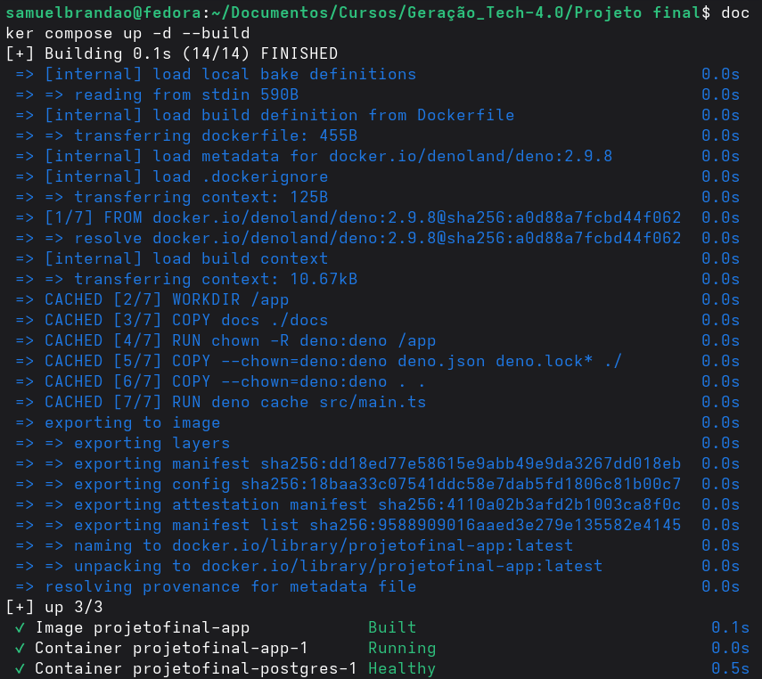
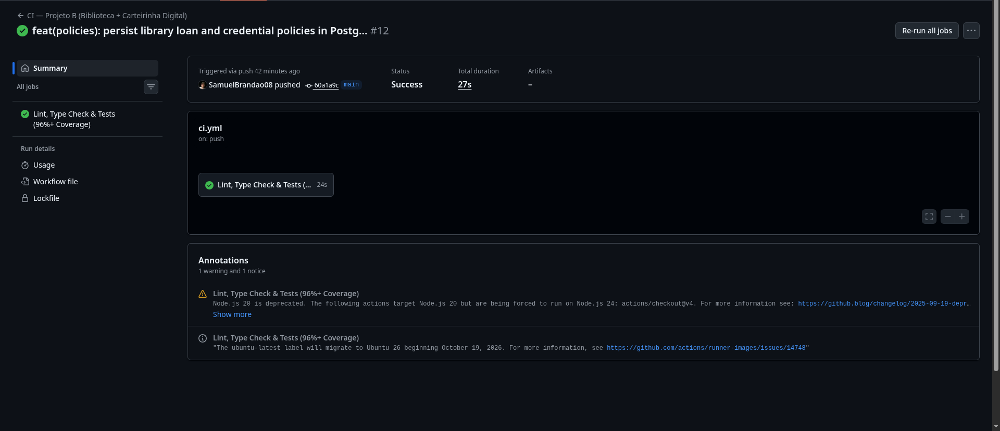
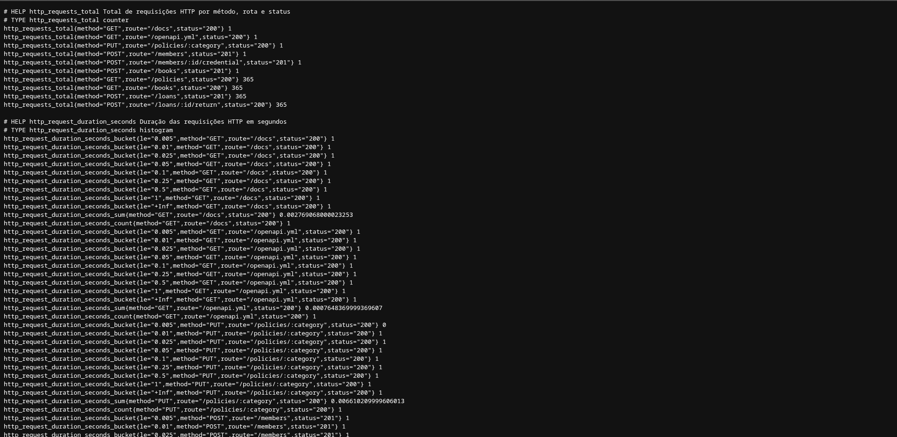

mkdir -p docs
cat << 'EOF' > docs/TEST_PLAN.md
# Plano e Suíte de Testes — API de Biblioteca com Carteirinha Digital

## 1. Estratégia de Testes e Pirâmide de Cobertura

A validação da aplicação é estruturada em quatro níveis complementares:

| Camada | Tipo de Teste | Escopo Validado | Ferramenta / Execução |
| :--- | :--- | :--- | :--- |
| **1. Domínio Puro** | Testes Unitários | Criptografia Ed25519, assinatura/verificação JWS, expiração temporal e regras de limite por categoria. | `deno test` (sem dependências externas) |
| **2. Persistência** | Testes de Integração (DB) | Migrações idempotentes, constraints SQL, índices únicos parciais e concorrência de empréstimos. | `deno test` + PostgreSQL |
| **3. Contrato e Fluxo** | Testes End-to-End (E2E) | Ciclo completo HTTP via Fastify (`app.inject`), validação de schemas Ajv, códigos de status e métricas. | `deno test` + Fastify + PostgreSQL |
| **4. Aceitação / Smoke** | Testes Funcionais Manuais | Interface Swagger UI (`/docs`), persistência real em container Docker e alteração dinâmica de políticas. | Navegador / `curl` / Docker Compose |

---

## 2. Casos de Teste Funcionais e de Regras de Negócio

### Módulo 1: Sistema e Observabilidade

| ID | Cenário de Teste | Pré-condição | Entrada / Ação | Resultado Esperado |
| :--- | :--- | :--- | :--- | :--- |
| **SYS-01** | Liveness check da API | API em execução | `GET /health` | Status `200 OK` com `{"status": "ok"}`. |
| **SYS-02** | Readiness check com PostgreSQL | Banco acessível | `GET /db-check` | Status `200 OK` confirmando conexão ativa. |
| **SYS-03** | Indisponibilidade do banco | Banco parado/inacessível | `GET /db-check` | Status `503 Service Unavailable`. |
| **SYS-04** | Exposição de métricas Prometheus | Requisições executadas | `GET /metrics` | Status `200 OK` em `text/plain` contendo contadores RED e métricas de negócio (`loans_denied_total`, etc.). |
| **SYS-05** | Contrato OpenAPI e Swagger UI | Arquivo `docs/openapi.yml` presente | `GET /openapi.yml` e `GET /docs` | Status `200 OK`; interface visual carrega rotas agrupadas em 6 tags. |

---

### Módulo 2: Gestão de Sócios

| ID | Cenário de Teste | Pré-condição | Entrada / Ação | Resultado Esperado |
| :--- | :--- | :--- | :--- | :--- |
| **MEM-01** | Cadastro de sócio válido | E-mail inédito | `POST /members` com `name`, `email` e `category` (`aluno`, `professor` ou `externo`) | Status `201 Created` retornando `id` (UUID) e dados cadastrados. |
| **MEM-02** | Bloqueio de e-mail duplicado | Sócio já cadastrado com o e-mail | `POST /members` com mesmo `email` | Status `409 Conflict` impedindo duplicidade. |
| **MEM-03** | Validação de payload inválido | Nenhuma | `POST /members` com e-mail malformado, categoria inexistente ou campo extra | Status `400 Bad Request` bloqueado pelo schema Ajv. |

---

### Módulo 3: Carteirinha Digital (JWS Ed25519)

| ID | Cenário de Teste | Pré-condição | Entrada / Ação | Resultado Esperado |
| :--- | :--- | :--- | :--- | :--- |
| **CRD-01** | Emissão de carteirinha assinada | Sócio cadastrado | `POST /members/{id}/credential` | Status `201 Created` retornando token JWS assinado em Ed25519 e `jti` (UUID). |
| **CRD-02** | Idempotência na emissão | Chave `Idempotency-Key` enviada | Duas chamadas `POST /members/{id}/credential` com mesmo header `Idempotency-Key` | 1ª chamada retorna `201 Created`; 2ª chamada retorna `200 OK` com o exato mesmo token e `jti`. |
| **CRD-03** | Emissão para sócio inexistente | UUID não cadastrado | `POST /members/{uuid-inexistente}/credential` | Status `404 Not Found`. |
| **CRD-04** | Revogação de carteirinha ativa | Carteirinha emitida | `POST /credentials/{jti}/revoke` | Status `200 OK` preenchendo `revoked_at` no PostgreSQL. |
| **CRD-05** | Revogação de carteirinha inexistente | JTI não cadastrado | `POST /credentials/{jti-inexistente}/revoke` | Status `404 Not Found`. |

---

### Módulo 4: Acervo e Exemplares Físicos

| ID | Cenário de Teste | Pré-condição | Entrada / Ação | Resultado Esperado |
| :--- | :--- | :--- | :--- | :--- |
| **BOK-01** | Cadastro de livro com exemplares | ISBN inédito | `POST /books` com `title`, `author`, `isbn` e `copyCodes` | Status `201 Created` criando o título e os exemplares físicos vinculados. |
| **BOK-02** | Listagem de catálogo e disponibilidade | Livros cadastrados | `GET /books` | Status `200 OK` listando livros e contagem atualizada de exemplares disponíveis. |
| **BOK-03** | Atualização parcial de metadados | Livro cadastrado | `PATCH /books/{id}` com novo `title`, `author` ou `isbn` | Status `200 OK` com metadados atualizados. |
| **BOK-04** | Conflito de ISBN na atualização | Dois livros cadastrados | `PATCH /books/{id}` usando o `isbn` do outro livro | Status `409 Conflict`. |
| **BOK-05** | Adição de novos exemplares físicos | Livro cadastrado | `POST /books/{id}/copies` com lista de novos `copyCodes` | Status `201 Created` incrementando o total de exemplares do livro. |
| **BOK-06** | Bloqueio de código de exemplar duplicado | `copyCode` já existente | `POST /books/{id}/copies` com código já utilizado | Status `409 Conflict`. |

---

### Módulo 5: Empréstimos, Segurança e Concorrência

| ID | Cenário de Teste | Pré-condição | Entrada / Ação | Resultado Esperado |
| :--- | :--- | :--- | :--- | :--- |
| **LON-01** | Empréstimo com credencial válida | Carteirinha ativa, exemplar livre e sócio dentro do limite | `POST /loans` com `credentialToken` e `copyId` | Status `201 Created` com `due_date` calculado conforme política da categoria. |
| **LON-02** | Rejeição de token adulterado ou expirado | Token alterado ou com `exp` vencido | `POST /loans` com token inválido | Status `401 Unauthorized` (`invalid_credential`) e incremento de métrica de negação. |
| **LON-03** | Rejeição de carteirinha revogada | Carteirinha revogada via `CRD-04` | `POST /loans` com token revogado | Status `403 Forbidden` (`credential_revoked`). |
| **LON-04** | Empréstimo de exemplar inexistente | UUID de exemplar não cadastrado | `POST /loans` com `copyId` inexistente | Status `404 Not Found`. |
| **LON-05** | Proteção de concorrência / exemplar ocupado | Exemplar já emprestado (sem devolução) | `POST /loans` simultâneo ou subsequente para o mesmo `copyId` | Status `409 Conflict` garantido pelo índice único parcial no PostgreSQL. |
| **LON-06** | Bloqueio por limite da categoria | Sócio atingiu `max_loans` (ex.: `externo` com 1 ativo) | `POST /loans` para um segundo exemplar disponível | Status `422 Unprocessable Entity` (`loan_limit_exceeded`). |
| **LON-07** | Devolução de empréstimo ativo | Empréstimo em aberto | `POST /loans/{id}/return` | Status `200 OK` liberando o exemplar para novos empréstimos e reduzindo contagem ativa do sócio. |
| **LON-08** | Devolução duplicada ou inexistente | Empréstimo já devolvido ou UUID inválido | `POST /loans/{id}/return` | Status `404 Not Found`. |

---

### Módulo 6: Políticas Dinâmicas no PostgreSQL

| ID | Cenário de Teste | Pré-condição | Entrada / Ação | Resultado Esperado |
| :--- | :--- | :--- | :--- | :--- |
| **POL-01** | Consulta de políticas vigentes | Migrações executadas | `GET /policies` | Status `200 OK` retornando as 3 categorias (`aluno`, `professor`, `externo`) com `max_loans`, `loan_days` e `credential_days`. |
| **POL-02** | Atualização dinâmica de política | Categoria válida | `PUT /policies/externo` com `{"max_loans": 2, "loan_days": 10, "credential_days": 45}` | Status `200 OK` persistindo os novos parâmetros no banco. |
| **POL-03** | Aplicação imediata da nova regra | Política de `externo` alterada para `max_loans: 2` | Sócio `externo` realiza o 2º empréstimo simultâneo sem reiniciar a API | Status `201 Created` (o que antes retornava `422` passa a ser permitido imediatamente). |
| **POL-04** | Validação de limites inválidos na política | Nenhuma | `PUT /policies/aluno` com `loan_days: 0` ou categoria inválida | Status `400 Bad Request`. |

---

## 3. Roteiro de Execução (Smoke Test Manual para Demonstração)

Para validar o ambiente completo de ponta a ponta antes da apresentação:

1. **Subir o ambiente isolado:**
   ```bash
   docker compose up -d --build

## Subir infraestrutura com um comando (docker compose up -d --build)



## Testes unitarios

deno task test:local
Task test:local deno test --env-file=.env --allow-read --allow-env --allow-sys --allow-net --coverage=coverage
running 4 tests from ./src/domain/credential/jws_test.ts
JWS: emite e verifica credencial válida ... ok (1ms)
JWS negativo: rejeita token expirado ... ok (341µs)
JWS negativo: rejeita ataque alg: none ... ok (126µs)
JWS negativo: rejeita kid desconhecido ... ok (163µs)
running 6 tests from ./src/domain/crypto/ed25519_test.ts
1. gera um par de chaves Ed25519 ... ok (739µs)
2. assina e verifica como válido ... ok (777µs)
3. payload alterado em UM caractere falha ... ok (291µs)
4. verifica só com a chave pública exportada/reimportada (JWK via JSON) ... ok (206µs)
5. negativo: assinatura de outra chave é rejeitada ... ok (257µs)
6. negativo: assinatura malformada retorna false e JWK inválido lança ... ok (826µs)
### running 4 tests from ./src/domain/library/policy_test.ts
7. policy: retorna limites corretos por categoria ... ok (469µs)
8. policy: permite empréstimo quando abaixo do limite ... ok (49µs)
9. policy: bloqueia empréstimo quando atinge ou excede o limite (caso de borda)
10. policy: bloqueia empréstimo quando atinge ou excede o limite (caso de borda) ... ok (21µs)
11. policy: calcula timestamp de expiração corretamente ... ok (24µs)
### running 2 tests from ./src/infra/db/connection_test.ts
12. connection: falha cedo se DATABASE_URL estiver ausente ... ok (573µs)
13. connection: checkDbHealth retorna false quando o banco falha ... ok (82µs)
### running 1 test from ./tests/api_flow_test.ts
14. API E2E: fluxo completo de sócio, carteirinha, empréstimo, erros e métricas 
15. API E2E: fluxo completo de sócio, carteirinha, empréstimo, erros e métricas ... ok (115ms)
### running 2 tests from ./tests/observability_test.ts
16. observability: contador e histograma aparecem em /metrics ... ok (37ms)
17. observability: createLogger respeita o nível informado ... ok (227µs)
### running 1 test from ./tests/repositories_test.ts
18. db integration: fluxo completo de persistência, concorrência e revogação ... ok (38ms)

ok | 20 passed | 0 failed (792ms)

| File                                 | Branch % | Function % | Line % |
| ------------------------------------ | -------- | ---------- | ------ |
| app.ts                               |     83.3 |      100.0 |   95.4 |
| domain/credential/jws.ts             |     85.7 |      100.0 |   91.9 |
| domain/crypto/ed25519.ts             |    100.0 |      100.0 |  100.0 |
| domain/library/policy.ts             |    100.0 |      100.0 |  100.0 |
| infra/db/connection.ts               |    100.0 |      100.0 |  100.0 |
| infra/db/repositories.ts             |     75.6 |      100.0 |   89.9 |
| infra/db/schema.ts                   |    100.0 |      100.0 |  100.0 |
| infra/observability/observability.ts |     83.3 |      100.0 |  100.0 |
| All files                            |     83.7 |      100.0 |   94.8 |
Lcov coverage report has been generated at file:///home/samuelbrandao/Documentos/Cursos/Gera%C3%A7%C3%A3o_Tech-4.0/Projeto%20final/coverage/lcov.info
HTML coverage report has been generated at file:///home/samuelbrandao/Documentos/Cursos/Gera%C3%A7%C3%A3o_Tech-4.0/Projeto%20final/coverage/html/index.html


## Pipeline CI no Github Actions


## Suiote de Teste K6

docker run --rm -i --network=host grafana/k6 run - < k6/smoke.js


  █ THRESHOLDS 

    http_req_duration
    ✓ 'p(95)<200' p(95)=4.02ms

    http_req_failed
    ✓ 'rate<0.01' rate=0.00%


  █ TOTAL RESULTS 

    checks_total.......: 1460    96.435916/s
    checks_succeeded...: 100.00% 1460 out of 1460
    checks_failed......: 0.00%   0 out of 1460

    ✓ GET /policies 200
    ✓ GET /books 200
    ✓ POST /loans 201
    ✓ POST /loans/:id/return 200

    HTTP
    http_req_duration..............: avg=1.63ms   min=255.65µs med=1ms      max=10.8ms   p(90)=3.78ms   p(95)=4.02ms  
      { expected_response:true }...: avg=1.63ms   min=255.65µs med=1ms      max=10.8ms   p(90)=3.78ms   p(95)=4.02ms  
    http_req_failed................: 0.00%  0 out of 1464
    http_reqs......................: 1464   96.700124/s

    EXECUTION
    iteration_duration.............: avg=207.09ms min=205.08ms med=206.71ms max=220.65ms p(90)=208.43ms p(95)=209.04ms
    iterations.....................: 365    24.108979/s
    vus............................: 5      min=5         max=5
    vus_max........................: 5      min=5         max=5

    NETWORK
    data_received..................: 703 kB 47 kB/s
    data_sent......................: 308 kB 20 kB/s


running (15.1s), 0/5 VUs, 365 complete and 0 interrupted iterations
default ✓ [ 100% ] 5 VUs  15s

### Metricas de logs 

http://localhost:8000/metrics

