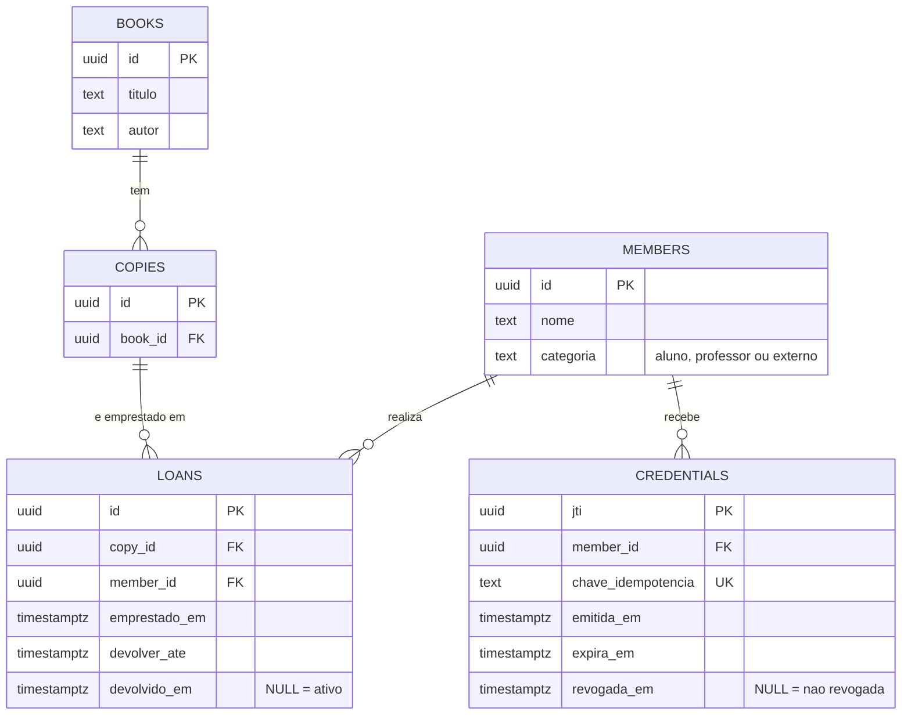

# Modelo de domínio

Projeto: biblioteca com carteirinha digital verificável (nível B, individual)

> **Status: rascunho para revisão.** Parte do conteúdo vem das respostas do aluno e parte foi acrescentada pelo tutor. Trechos marcados com **[AJUSTE]** mudam algo do que o aluno escreveu; trechos com **[ADIÇÃO]** são novos. Depois da revisão, remover as marcações.

## 0. Vocabulário

| Termo | Significado |
|---|---|
| Sócio | Pessoa cadastrada na biblioteca, com uma categoria (aluno, professor ou externo) |
| Carteirinha (credencial) | Documento assinado que o sócio apresenta a cada empréstimo. Formato: JWS compacto, assinado com Ed25519 (ver ADR-0002) |
| Emissor | A própria biblioteca, dona do par de chaves. A chave privada fica só no ambiente do servidor |
| Exemplar | Cópia física de um livro. **O empréstimo é de um exemplar**, não de um livro |
| Empréstimo ativo | Empréstimo com `devolvido_em` nulo |
| Revogação | Ato de invalidar uma carteirinha antes da validade (por exemplo, suspensão do sócio) |

## 1. Invariantes

Invariante é uma regra que nunca pode ser violada, mesmo sob concorrência ou requisição maliciosa. Para cada uma: onde é garantida, como e qual teste a comprova.

**[AJUSTE]** O aluno indicou "tratar na API" para várias regras. A regra em si fica no **domínio** (código sem HTTP, fácil de testar sozinho), ou no **serviço de aplicação** quando precisa consultar o banco. A camada de API apenas traduz o resultado em código HTTP. Isso mantém as regras testáveis sem subir servidor.

| ID | Regra (nunca pode ser violada) | Onde é garantida | Como | Teste que comprova | Erro |
|---|---|---|---|---|---|
| I1 | Um exemplar não pode ter dois empréstimos ativos ao mesmo tempo | **Banco** (garantia final) e aplicação (verificação prévia para erro amigável) | Índice único parcial em `loans(copy_id)` onde `devolvido_em` é nulo. A transação só se efetiva se o banco aceitar; a segunda tentativa recebe violação de unicidade (código `23505`), traduzida para 409 | Integração, banco real: N requisições simultâneas para o mesmo exemplar resultam em **exatamente 1 sucesso e N-1 respostas 409** | 409 |
| I2 | Um sócio não pode exceder o limite de empréstimos ativos da sua categoria | **Domínio** (regra) e **banco** (serialização sob concorrência) | Regra pura: limite por categoria. **[ADIÇÃO]** Verificar e inserir é uma sequência que pode falhar com requisições simultâneas do mesmo sócio. Proposta: transação que trava a linha do sócio (`SELECT ... FOR UPDATE`) antes de contar. Ainda não validada | Unitário: limite menos 1 passa, limite exato bloqueia, para cada categoria. Integração: requisições simultâneas do mesmo sócio nunca ultrapassam o limite | 422 |
| I3 | Só se aceita credencial com assinatura EdDSA válida, de emissor conhecido e algoritmo fixado | **Domínio puro** (sem banco) | Verificação rejeita qualquer `alg` diferente de EdDSA (inclui `none`), `kid` desconhecido e estrutura que não seja um JWS compacto de 3 partes | Unitários negativos: payload alterado em 1 caractere, assinatura de outra chave, `alg: none`, `alg: HS256`, `kid` desconhecido, JWS malformado | 401 |
| I4 | Credencial expirada nunca é aceita | **Domínio puro**, com relógio injetado | O instante atual é passado como parâmetro, nunca lido direto dentro da regra | Unitário com relógio falso, incluindo a borda (um instante antes e no instante de expiração) | 401 |
| I5 | Credencial revogada nunca é aceita | **Serviço de aplicação** (consulta o banco) | Consulta `credentials.revogada_em` pelo `jti` | Unitário com repositório falso. Integração: emitir, revogar e tentar emprestar, resultando em erro | 401 |
| I6 | Sócio e exemplar referenciados precisam existir | **Banco** (chaves estrangeiras) e aplicação (resposta 404) | FKs em `loans`; a aplicação verifica antes e responde com erro claro | Integração: exemplar inexistente, sócio inexistente na emissão | 404 |
| I7 | Um exemplar já emprestado não pode ser emprestado de novo | **Aplicação** (verificação prévia) e **banco** (I1 como garantia) | Verificação para erro amigável; a corrida real é decidida pelo banco | Mesmo teste de I1, mais um teste sequencial simples | 409 |
| I8 | Um empréstimo só pode ser devolvido pelo sócio que o fez, e uma vez só | **Domínio** e **banco** | Atualização condicional: `UPDATE ... WHERE id = ? AND devolvido_em IS NULL`; comparação do sócio da credencial com o do empréstimo | Integração: devolver duas vezes (segunda recebe 409); devolver com a credencial de outro sócio (403) | 403, 409 |
| I9 **[ADIÇÃO]** | A credencial carrega só identidade e categoria. O limite de empréstimos **não** é assinado dentro dela | **Domínio** | Tabela de limites no código. Um número assinado ficaria desatualizado se a regra mudasse | Unitário: o payload emitido não contém limite; alterar a tabela muda o comportamento sem reemitir credenciais | n/a |
| I10 **[ADIÇÃO]** | Emissão e revogação só por quem tem a chave de API do emissor; emissão é idempotente | **API** (autenticação) e **banco** (chave de idempotência única) | Cabeçalho `Idempotency-Key` guardado em `credentials` com restrição de unicidade | Integração: sem chave de API (401); mesma `Idempotency-Key` devolve a mesma credencial | 401, 422 |
| I11 **[ADIÇÃO]** | A chave privada do emissor nunca aparece em código, resposta nem log | **Configuração e segurança** | Só por variável de ambiente; varredura de segredos no CI | gitleaks no pipeline; teste que verifica que resposta e log de uma emissão não contêm o material da chave | n/a |

Sobre a pergunta do exemplo (duas requisições ao mesmo exemplar ao mesmo tempo): a decisão do aluno está correta. Quem decide é o **banco**, porque ele é o único ponto em comum entre todas as requisições e instâncias da aplicação. Qualquer verificação feita antes na aplicação é só cortesia para dar uma mensagem melhor; ela sozinha deixa uma janela de corrida. O índice único parcial foi validado na spike (`docs/spike-deno.md`).

## 2. Diagrama entidade-relacionamento



Notas de modelagem:

- **[AJUSTE]** Na Etapa 1 o exemplar tinha um campo `status`. Aqui ele foi removido: **disponível significa não existir empréstimo ativo para o exemplar**. Guardar o status também criaria duas fontes de verdade que podem divergir. O índice único parcial em `loans(copy_id)` onde `devolvido_em` é nulo é o que sustenta isso.
- O limite por categoria **não é coluna do banco**; é uma tabela de regras no código (I9). Valores **propostos, a validar pelo aluno**: aluno 3, professor 5, externo 2.
- O emissor não tem tabela: o par de chaves vem do ambiente, e o `kid` no cabeçalho do JWS identifica qual chave pública verifica. Isso deixa a rotação de chaves possível no futuro sem implementá-la agora.

Conteúdo da carteirinha (JWS compacto `cabecalho.payload.assinatura`, cada parte em base64url):

```
cabeçalho:  { "alg": "EdDSA", "kid": "<identificador da chave do emissor>" }
payload:    { "jti": "<id da credencial>", "sub": "<id do sócio>",
              "categoria": "aluno | professor | externo",
              "iat": <emissão>, "exp": <expiração> }
```

## 3. Catálogo de erros

**Decisão central:** "credencial inválida" e "regra de negócio violada" são **classes diferentes de erro**, e a diferença é de quem é o problema:

- **Credencial inválida (401)**: não conseguimos confiar em quem está pedindo. Nenhuma regra de negócio chega a ser avaliada.
- **Regra de negócio violada (409 ou 422)**: sabemos quem é o sócio, a credencial vale, mas o pedido contraria o estado ou as regras da biblioteca.

Assinatura inválida, credencial expirada e credencial revogada ficam todas na classe 401, mas com **códigos de erro distintos**, porque o sócio age de modo diferente em cada caso (pedir uma nova carteirinha, renovar ou procurar a biblioteca). **Revogada é 401 e não 403**: a credencial deixou de provar identidade. O 403 fica para "identidade conhecida, ação não permitida".

Formato proposto do corpo de erro: `{ "error": { "code": "<codigo>", "message": "<texto curto>" } }`. Mensagens não revelam detalhes internos (pilha, SQL, caminhos).

| HTTP | Código | Situação |
|---|---|---|
| 400 | `requisicao_invalida` | Corpo fora do schema, campo faltando, tipo errado, identificador mal formado |
| 401 | `credencial_ausente` | Operação que exige carteirinha chegou sem ela |
| 401 | `credencial_malformada` | Não é um JWS compacto de 3 partes |
| 401 | `credencial_assinatura_invalida` | Assinatura não confere, ou `alg` diferente de EdDSA |
| 401 | `credencial_emissor_desconhecido` | `kid` não corresponde a nenhuma chave conhecida |
| 401 | `credencial_expirada` | `exp` já passou |
| 401 | `credencial_revogada` | `jti` consta como revogado |
| 401 | `chave_emissor_invalida` | Emissão ou revogação sem a chave de API do emissor, ou com chave errada |
| 403 | `operacao_nao_permitida` | Credencial válida, mas tenta devolver empréstimo de outro sócio |
| 404 | `exemplar_nao_encontrado` | Exemplar inexistente (**[AJUSTE]** o "livro inexistente" do aluno vira "exemplar", pois o empréstimo é por exemplar) |
| 404 | `socio_nao_encontrado` | Emissão de carteirinha para sócio inexistente |
| 404 | `emprestimo_nao_encontrado` | Devolução de empréstimo inexistente |
| 409 | `exemplar_indisponivel` | Exemplar já tem empréstimo ativo. Inclui o caso da corrida, quando o banco rejeita com `23505` |
| 409 | `emprestimo_ja_devolvido` | Devolução repetida |
| 422 | `limite_emprestimos_excedido` | Pedido válido, mas o sócio atingiu o limite da categoria |
| 422 | `chave_idempotencia_conflitante` | Mesma `Idempotency-Key` reutilizada com corpo diferente |
| 503 | `servico_indisponivel` | **Dependência** fora do ar (por exemplo, banco). Só falha de dependência vira 503 |
| 500 | `erro_interno` | Bug do próprio código. Registrar o erro completo no log, nunca expor o detalhe |

Por que 409 para exemplar indisponível e 422 para limite excedido: o 409 indica **conflito com o estado atual do recurso** (o exemplar está ocupado, e pode ficar livre depois). O 422 indica que o pedido é bem formado, mas **contraria uma regra**. Essa fronteira é uma convenção discutível, então fica registrada como decisão do projeto.

Lição da spike aplicada aqui: o `catch` genérico que devolvia 503 escondeu um erro de código. Por isso 503 e 500 são linhas separadas.

## 4. Fora do escopo

Por escrito, para controlar o escopo em 5 dias:

- Multas, cobrança e débitos de sócio (ver ponto 1 da próxima seção)
- Reservas de livros e fila de espera
- Renovação de empréstimos
- Busca avançada, paginação e ordenação do catálogo
- Edição e exclusão de livros e de sócios
- Interface web
- DID, blockchain, JSON-LD e W3C Verifiable Credentials completo
- Divulgação seletiva e provas de conhecimento zero
- Carteira digital no dispositivo do sócio (o sócio apenas guarda e apresenta o token)
- Vários emissores e rotação de chaves (existe um único emissor; o `kid` deixa a porta aberta)
- Notificações (e-mail, SMS)

## 5. Pontos para decisão do aluno

1. **"Usuário com débito"**. O combinado inicial era sem multas. Sugestão: **tratar como fora do escopo** e usar a revogação da carteirinha como mecanismo de suspensão (já coberta por I5). Se o aluno quiser uma regra própria, é preciso decidir o que é "débito" (um campo `bloqueado` no sócio?) e a regra entra como uma nova invariante com erro 422.
2. **Empréstimo por exemplar.** O pedido de empréstimo informa o identificador do exemplar. A alternativa, informar o livro e deixar o sistema escolher um exemplar livre, adiciona lógica de escolha e concorrência. Sugestão: manter por exemplar.
3. **Valores dos limites** por categoria (proposta: 3, 5 e 2).
4. **Revogada como 401 e limite como 422**: confirmar as duas convenções ou propor outras.
5. **Sócio da credencial que não existe mais** (por exemplo, banco recriado): sugestão de tratar como 401, porque a credencial já não prova nada. Hoje não há exclusão de sócios no escopo, então o caso é raro.

## 6. Critérios de aceitação deste documento

- [ ] Toda invariante está ligada a uma camada e a um teste.
- [ ] O diagrama renderiza no GitHub.
- [ ] O catálogo distingue "credencial inválida" de "regra de negócio violada".
- [ ] ADR-0002 tem pelo menos uma alternativa descartada com motivo (`docs/adr/0002-formato-da-credencial.md`).
- [ ] Os pontos da seção 5 foram decididos.
